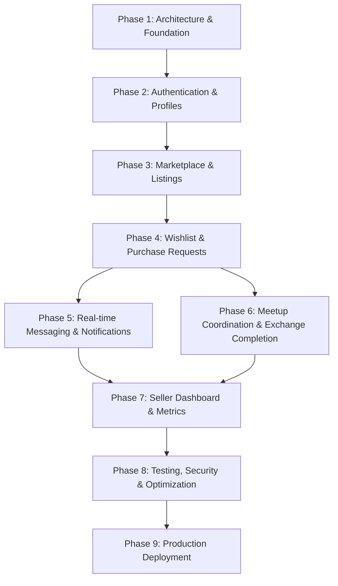

# ReThread — Phased Development Roadmap

This document outlines the step-by-step phased execution plan for building ReThread. To ensure production quality and prevent unmaintainable monolithic generation, development proceeds strictly phase by phase.

---

## Roadmap Overview

---

## Phase 1 — Foundation & Monorepo Setup (Current Phase)
**Goal:** Establish clean monorepo architecture, initialize frontend & backend, configure database & migrations, verify end-to-end communication.

### Deliverables:
1. `Rules.md`, `Phases.md`, `Design.md`, `docs/architecture.md`
2. Monorepo folder layout: `frontend/`, `backend/`, `docs/`
3. Next.js 14+ App Router project initialized with TypeScript, Tailwind CSS, Lucide icons
4. FastAPI backend initialized with structured modular layers
5. PostgreSQL database setup with SQLAlchemy 2.0 and Alembic configuration
6. Core database models (Colleges, Users, Profiles, Categories, Listings, Transactions, etc.)
7. Initial Alembic migration executed
8. Health check endpoint `/api/v1/health` responding with status and DB connectivity
9. Centralized frontend API client configured with Axios/fetch wrapper and typed contract
10. Live connectivity verification between Next.js and FastAPI

---

## Phase 2 — Authentication & Profile Management
**Goal:** Full user lifecycle, campus domain verification, session security, and student profile.

### Deliverables:
1. College email verification flow (`.ac.in` domain checking, token generation, SMTP email integration)
2. User registration, login, logout, and token refresh endpoints
3. Secure HttpOnly cookie session management
4. Password reset and email token resend with rate-limiting
5. Public & private Student Profile management (Department, Academic Year, Bio, Avatar)
6. Frontend Auth UI (Login, Register, Verify Email, Forgot Password) faithful to `s1`, `s2`, `s3`
7. Persistent Buy/Sell Mode switcher state in frontend header

---

## Phase 3 — Marketplace & Product Listings
**Goal:** Core catalog discovery, search, filtering, and seller listing creation workflow.

### Deliverables:
1. Category management and initial seed data for campus thrift goods
2. Listing CRUD API with status transitions (`draft`, `active`, `archived`)
3. Cloudinary image upload integration (backend-authenticated, max 5 images, WebP conversion)
4. Marketplace search, filtering (category, price range, condition), sorting, and pagination
5. Discover page (`s4`) and Explore page with faceted filters (`s5`)
6. Product Details view (`s6`) with multi-image gallery, seller card, and verified badge
7. Seller 4-Step Listing Creation Flow (`s13`, `s14`, `s15`): Photos → Details → Pricing (INR) → Preview

---

## Phase 4 — Wishlist & Purchase Requests
**Goal:** Buyer intent signaling, atomic reservations, and concurrency control.

### Deliverables:
1. Wishlist API with unique user-listing constraints and quick toggle
2. Wishlist UI (`s7`) synchronized with real-time listing availability
3. Purchase Request creation workflow with optional buyer message
4. Seller Enquiry management view (`s16`) with Accept / Reject capabilities
5. Atomic reservation locking (`SELECT FOR UPDATE`) to prevent double-selling
6. Automatic state transition to `reserved` upon seller acceptance

---

## Phase 5 — Real-Time Messaging & Notifications
**Goal:** Contextual buyer-seller communication and persistent notification delivery.

### Deliverables:
1. Conversation and Message models linked to listings/transactions
2. Authenticated WebSocket endpoint (`/api/v1/ws`) with conversation isolation
3. Persistent chat storage in PostgreSQL with message history pagination
4. Real-time messaging UI (`s8`) with sending, sent, and failed states
5. Notification service triggering alerts for requests, acceptances, and messages
6. Notification badge and flyout with unread counts

---

## Phase 6 — Meetup Coordination & Exchange Completion
**Goal:** Offline campus meetup scheduling and dual-confirmation transaction finalization.

### Deliverables:
1. Campus meetup scheduler (time & designated campus landmark selection)
2. State transition to `meetup_scheduled`
3. Dual-confirmation workflow: both Buyer and Seller must submit completion confirmation
4. State transition to `completed` and listing status update to `sold`
5. Transaction cancellation and dispute reporting handlers
6. Sales History screen (`s17`) and active transaction tracker

---

## Phase 7 — Seller Dashboard & Listing Performance
**Goal:** Comprehensive seller portal with live-calculated analytics.

### Deliverables:
1. Seller Dashboard (`s11`) featuring live metrics: Active listings, Total Views, Pending Enquiries, Completed Sales
2. My Listings management table/grid (`s12`) with quick status toggles and edit actions
3. Seller public profile and reputation page (`s18`)
4. Data aggregations computed directly via database queries (strictly no dummy numbers)

---

## Phase 8 — Testing, Security Hardening & Polish
**Goal:** Automated testing, responsive validation across breakpoints, and production hardening.

### Deliverables:
1. Pytest suite covering auth, double-selling concurrency, dual confirmation, and permissions
2. Vitest & Playwright E2E tests for core flows (register → list → request → complete)
3. Responsive UI audit across mobile (390px), tablet (768px), and desktop (1280px+)
4. Security checklist: CORS origin lockdown, CSRF protection, rate limits, input sanitization

---

## Phase 9 — Production Deployment
**Goal:** Deployment configuration for cloud infrastructure.

### Deliverables:
1. Backend containerization / configuration for Render/Railway
2. Frontend deployment configuration for Vercel
3. PostgreSQL connection pooling & Alembic migration automation
4. Cloudinary production bucket & SMTP credentials setup
5. Production smoke testing and handover
