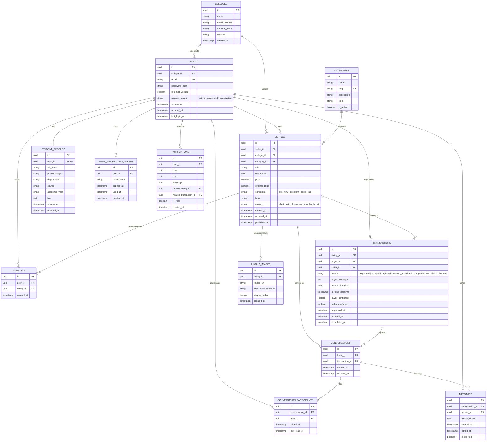

# ReThread — Technical Architecture & System Specification

## 1. Executive Summary & Architectural Overview

ReThread is a student-exclusive campus thrift marketplace built exclusively for offline, in-person campus exchanges within higher education institutions. The system facilitates discovery, filtering, intent-to-buy requests, atomic reservations, messaging, and dual-confirmation transaction tracking.

```
+-----------------------------------------------------------------------------------+
|                           Next.js 14+ App Router Frontend                         |
|  (TypeScript, Tailwind CSS, TanStack Query, Zustand, React Hook Form, Lucide)     |
+----------------------------------------+------------------------------------------+
                                         | REST / JSON (HTTP)
                                         | WebSockets (WSS)
                                         v
+-----------------------------------------------------------------------------------+
|                              FastAPI Async Backend                                |
|  - Auth & Security: JWT in HttpOnly Cookies, Argon2/Bcrypt, Rate Limiting         |
|  - Business Services Layer: Concurrency locks, state transitions, validation      |
|  - Real-Time Hub: WebSocket Connection Manager for chat & notifications           |
+--------------------+---------------------------------------+----------------------+
                     |                                       |
                     v                                       v
+--------------------+--------------+      +-----------------+----------------------+
|  PostgreSQL Database (SQLAlchemy) |      |        Cloudinary Media Storage        |
|  - 13 Core Tables + Migrations    |      |  - Signed server-side image upload     |
|  - UUID PKs, Numeric Currencies   |      |  - Auto-optimization (WebP)            |
|  - Row-Level Locking (Concurrency)|      +----------------------------------------+
+-----------------------------------+
```

---

## 2. Screen-to-Feature Mapping

Every screen provided in the Figma design suite (`s1` through `s21`) is mapped to its corresponding Next.js route, feature domain, and access level:

| Screen | Design Name / Context | Next.js Route | Feature Domain | Access Level | Key Capabilities |
|---|---|---|---|---|---|
| **s1** | Login Screen | `/login` | Auth | Public / Guest | Email/password login, remember me, error alerts, forgot pass link |
| **s2** | Student Registration | `/register` | Auth | Public / Guest | College email validation (`.ac.in`), student details, password |
| **s3** | Email Verification | `/verify-email` | Auth | Pending Verification | 6-digit or link token input, resend button with countdown |
| **s4** | Discover Page | `/discover` (or `/`) | Marketplace | Authenticated (Buy Mode) | Hero banner, categories bar, trending thrift picks, recent listings |
| **s5** | Explore & Filter | `/explore` | Marketplace | Authenticated (Buy Mode) | Search bar, faceted sidebar (categories, price slider, condition) |
| **s6** | Product Details | `/product/[id]` | Marketplace | Authenticated (Buy Mode) | Image gallery, seller card, verified badge, "Request to Buy", Wishlist |
| **s7** | Wishlist | `/wishlist` | Wishlist | Authenticated (Buy Mode) | Saved items grid, active/reserved availability status, quick remove |
| **s8** | Messages & Chat | `/messages` | Messaging | Authenticated (Both Modes) | Conversation sidebar, chat thread, contextual listing banner, real-time |
| **s9** | Buyer Profile / Seller Mini-Card | `/users/[id]` | Profile | Authenticated (Both Modes) | Public profile, verified badge, major, graduation year, active listings |
| **s10** | Campus Onboarding / Selector | `/onboarding` | Onboarding | Authenticated (First login) | College affiliation confirmation, department selection, bio setup |
| **s11** | Seller Dashboard | `/dashboard` | Seller Portal | Authenticated (Sell Mode) | Metrics cards (Active, Views, Enquiries, Sold), performance chart |
| **s12** | My Listings | `/listings` | Seller Portal | Authenticated (Sell Mode) | Tabbed view (Active, Reserved, Draft, Sold), quick edit, archive |
| **s13** | Create Listing — Photos (Step 1) | `/listings/create` | Seller Portal | Authenticated (Sell Mode) | Drag-and-drop upload (up to 5), image reordering, primary flag |
| **s14** | Create Listing — Details (Step 2) | `/listings/create` | Seller Portal | Authenticated (Sell Mode) | Title, category dropdown, condition pills, brand, description |
| **s15** | Create Listing — Pricing (Step 3) | `/listings/create` | Seller Portal | Authenticated (Sell Mode) | Price in INR (₹), original retail price, savings calculation |
| **s16** | Buyer Enquiries | `/enquiries` | Seller Portal | Authenticated (Sell Mode) | Incoming purchase requests, buyer message, Accept / Reject buttons |
| **s17** | Sales History | `/sales` | Seller Portal | Authenticated (Sell Mode) | Completed sales ledger, transaction timeline, buyer info, dual-confirm status |
| **s18** | Seller Profile & Reviews | `/profile` | Profile | Authenticated (Both Modes) | Editable profile details, campus verification status, selling stats |
| **s19** | Pattern Sheet — Catalogue & Chat | Reusable Library | Design System | Shared | Status badges, chat bubble states, product card states |
| **s20** | Pattern Sheet — Forms & Stepper | Reusable Library | Design System | Shared | Stepper navigation, floating inputs, error states, toggles |
| **s21** | Pattern Sheet — Responsive & Map | Reusable Library | Design System | Shared | Responsive grid definitions, breakpoint rules, user journey map |

---

## 3. Frontend Component Architecture

```
frontend/src/
├── app/                              # Next.js App Router root
│   ├── (auth)/                       # Unauthenticated route group
│   │   ├── login/page.tsx
│   │   ├── register/page.tsx
│   │   ├── verify-email/page.tsx
│   │   └── forgot-password/page.tsx
│   ├── (marketplace)/                # Buy Mode route group
│   │   ├── discover/page.tsx
│   │   ├── explore/page.tsx
│   │   ├── product/[id]/page.tsx
│   │   ├── wishlist/page.tsx
│   │   ├── messages/page.tsx
│   │   └── profile/page.tsx
│   ├── (seller)/                     # Sell Mode route group
│   │   ├── dashboard/page.tsx
│   │   ├── listings/page.tsx
│   │   ├── listings/create/page.tsx
│   │   ├── enquiries/page.tsx
│   │   └── sales/page.tsx
│   ├── notifications/page.tsx
│   ├── layout.tsx                    # Root shell layout
│   └── page.tsx                      # Root redirect (discover or dashboard)
│
├── components/                       # Reusable UI component library
│   ├── common/                       # Base design primitives
│   │   ├── Button.tsx
│   │   ├── Input.tsx
│   │   ├── Badge.tsx
│   │   ├── Modal.tsx
│   │   └── Skeleton.tsx
│   ├── layout/                       # Structural layouts
│   │   ├── Header.tsx                # Includes ModeSwitcher, Campus pill, Search
│   │   ├── Footer.tsx
│   │   └── Sidebar.tsx
│   ├── navigation/
│   │   ├── ModeSwitcher.tsx          # Buy / Sell persistent toggle
│   │   └── UserNav.tsx
│   ├── products/
│   │   ├── ProductCard.tsx           # Standard thrift product card
│   │   ├── ProductGrid.tsx           # Responsive 4/3/2 column grid
│   │   └── FilterSidebar.tsx         # Faceted filters
│   ├── listings/
│   │   ├── ListingStepper.tsx        # 4-step wizard
│   │   ├── PhotoUploader.tsx         # Drag-and-drop 5-image manager
│   │   └── ListingRow.tsx            # Seller management table row
│   ├── messaging/
│   │   ├── ConversationList.tsx
│   │   ├── MessageThread.tsx
│   │   └── MessageInput.tsx
│   └── notifications/
│       └── NotificationFlyout.tsx
│
├── lib/
│   ├── api/
│   │   ├── client.ts                 # Centralized Axios / Fetch instance
│   │   ├── endpoints.ts              # Typed endpoint constants
│   │   └── error.ts                  # Normalized error response parser
│   ├── validation/                   # Zod schemas matching backend Pydantic
│   │   ├── auth.ts
│   │   ├── listing.ts
│   │   └── transaction.ts
│   └── utils/                        # Formatting helpers (currency INR, dates)
│
└── store/                            # Global client state (Zustand)
    ├── useModeStore.ts               # Buy vs Sell mode state
    ├── useAuthStore.ts               # Current user profile cache
    └── useNotificationStore.ts       # Unread count & real-time badge
```

---

## 4. Backend Module Architecture

```
backend/app/
├── main.py                           # FastAPI application entry & CORS middleware
├── core/
│   ├── config.py                     # Pydantic Settings from .env
│   ├── security.py                   # JWT creation, Argon2/Bcrypt hashing
│   └── dependencies.py               # get_db, get_current_user, get_verified_user
├── db/
│   ├── base.py                       # SQLAlchemy DeclarativeBase
│   ├── session.py                    # async_sessionmaker & engine
│   └── migrations/                   # Alembic versions
├── models/                           # SQLAlchemy 2.0 ORM entities
│   ├── college.py
│   ├── user.py
│   ├── profile.py
│   ├── category.py
│   ├── listing.py
│   ├── transaction.py
│   ├── conversation.py
│   ├── message.py
│   └── notification.py
├── schemas/                          # Pydantic v2 validation contracts
│   ├── auth.py
│   ├── user.py
│   ├── listing.py
│   ├── transaction.py
│   ├── message.py
│   └── notification.py
├── api/v1/                           # HTTP Route Handlers (thin controllers)
│   ├── auth.py
│   ├── users.py
│   ├── listings.py
│   ├── wishlist.py
│   ├── transactions.py
│   ├── conversations.py
│   ├── notifications.py
│   ├── seller.py
│   └── health.py
├── services/                         # Core Business Logic & State Machines
│   ├── auth_service.py
│   ├── listing_service.py
│   ├── transaction_service.py        # Concurrency & row-level locking
│   ├── messaging_service.py
│   └── notification_service.py
├── repositories/                     # Direct SQLAlchemy 2.0 DB interactions
├── integrations/
│   ├── cloudinary_service.py         # Cloudinary signed upload & cleanup
│   └── email_service.py              # Verification & notification emails
└── websocket/
    ├── connection_manager.py         # Active WebSocket client registry
    └── router.py                     # /api/v1/ws endpoint with JWT auth
```

---

## 5. Entity Relationship Diagram (ERD)



---

## 6. Screen-to-API Endpoint Mapping

| Screen | Primary Endpoints Invoked | HTTP Method & Path |
|---|---|---|
| **s1 (Login)** | Authenticate student | `POST /api/v1/auth/login` |
| **s2 (Register)** | Register new student profile | `POST /api/v1/auth/register` |
| **s3 (Verify Email)** | Verify email token / Resend code | `POST /api/v1/auth/verify-email`<br>`POST /api/v1/auth/resend-verification` |
| **s4 (Discover)** | Fetch recent listings, categories | `GET /api/v1/listings?sort=recent&limit=12`<br>`GET /api/v1/categories` |
| **s5 (Explore)** | Faceted search & filtered listings | `GET /api/v1/listings?category=&min_price=&max_price=&condition=&q=&page=` |
| **s6 (Product Details)** | Listing details, seller card, send request, wishlist toggle | `GET /api/v1/listings/{id}`<br>`POST /api/v1/transactions` (Request to buy)<br>`POST /api/v1/wishlist/{id}` |
| **s7 (Wishlist)** | Get saved items, remove item | `GET /api/v1/wishlist`<br>`DELETE /api/v1/wishlist/{id}` |
| **s8 (Messages)** | Fetch conversations, load history, send via WS | `GET /api/v1/conversations`<br>`GET /api/v1/conversations/{id}/messages`<br>`WS /api/v1/ws` |
| **s9 / s18 (Profile)** | Get user profile, update details | `GET /api/v1/users/{id}`<br>`PATCH /api/v1/users/me` |
| **s11 (Dashboard)** | Real-time seller metrics | `GET /api/v1/seller/dashboard/summary`<br>`GET /api/v1/seller/dashboard/activity` |
| **s12 (My Listings)** | Seller listings with statuses | `GET /api/v1/seller/listings?status=`<br>`POST /api/v1/seller/listings/{id}/archive` |
| **s13-s15 (Create)** | Image upload, publish listing | `POST /api/v1/uploads/listing-images`<br>`POST /api/v1/seller/listings` |
| **s16 (Enquiries)** | List requests, Accept/Reject | `GET /api/v1/transactions/seller`<br>`POST /api/v1/transactions/{id}/accept`<br>`POST /api/v1/transactions/{id}/reject` |
| **s17 (Sales History)** | Completed ledger, confirm meetup | `GET /api/v1/transactions/seller?status=completed`<br>`POST /api/v1/transactions/{id}/schedule-meetup`<br>`POST /api/v1/transactions/{id}/confirm-completion` |

---

## 7. Analysis of UI Inconsistencies vs. Technical Specification

During the deep-dive design audit of `s1`–`s21`, the following discrepancies were identified and resolved architecturally:

1. **Discrepancy: E-Commerce "Cart" / "Checkout" visual hints vs. Strictly Offline Campus Meetup**:
   - *Observation*: Some generic marketplace mockups visually resemble online e-commerce checkout funnels.
   - *Resolution*: Strictly replace any "Buy Now" or "Checkout" button with **"Request to Buy"**. The flow initiates a purchase request that transitions to `requested` -> `accepted` (reserved) -> `meetup_scheduled` -> `completed` (dual confirmation) without ever touching a payment gateway.

2. **Discrepancy: "Verified Student" Badge Interpretation**:
   - *Observation*: The UI features a prominent "Verified Student" badge on profiles and product cards.
   - *Resolution*: Email domain verification verifies control of an official collegiate `.ac.in` email address. The architecture implements domain whitelisting per college, but will not claim formal enrollment verification in security documentation.

3. **Discrepancy: Dual Mode Navigation vs. Auth Session**:
   - *Observation*: The user can toggle between Buy Mode and Sell Mode seamlessly.
   - *Resolution*: This is maintained in client-side state (`useModeStore.ts`). Both modes share the same authenticated JWT session and college ID; the backend evaluates ownership per resource rather than switching roles.

4. **Discrepancy: 4-Step Listing Creation Form State**:
   - *Observation*: The listing creation is split across screens `s13` (Photos), `s14` (Details), `s15` (Pricing), and a final Preview.
   - *Resolution*: The frontend will manage multi-step wizard state with React Hook Form + Zustand so that navigation between steps preserves all inputs and validated Cloudinary image references before invoking `POST /api/v1/seller/listings`.
